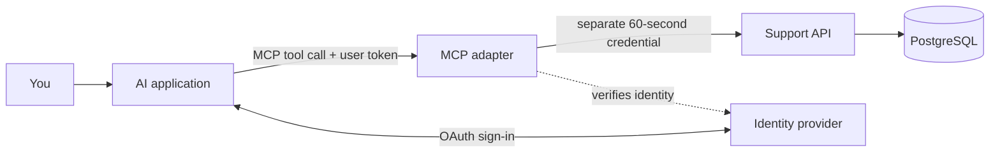

# MCP explained: build a server for your API

The companion code for Neeraj Butola's MCP video. Follow one support-ticket example from an existing HTTP API to an authenticated MCP server, then connect a real client.

**Start locally.** You do not need Auth0, Neon, Vercel, an OpenAI API key or a paid AI account for the local walkthrough. The hosted chapter is a separate deployment using your own accounts.

This is a production-oriented teaching reference. It includes real authentication, company isolation, bounded requests and safe write retries. A production launch still needs the checks in [Operations](docs/OPERATIONS.md).

## What you will build



The AI application is the **host**. Its MCP **client** connects to our MCP **server**. The server describes four tools and calls the existing API. The API still checks permissions and company boundaries.

| Tool | Purpose |
| --- | --- |
| `list_tickets` | Find a small page of ticket summaries |
| `get_ticket` | Read one ticket in the signed-in user's company |
| `prepare_ticket` | Validate proposed contents and return an immutable preview |
| `create_ticket` | Commit the reviewed draft; retry the same handle to avoid duplicates |

## Requirements

- Node.js **24.x** and npm (check `node --version`).
- Docker Engine with Docker Compose v2, or Docker Desktop, running locally.
- A browser for Inspector and the local sign-in page.
- Free local ports **4310**, **4311**, **5547**, **8187**, and Inspector's **6274–6277** range.

Dependencies and container digests are pinned. Use `npm ci`; do not replace packages with `latest` while following this recording. This example uses the **TypeScript SDK v2** package layout; v1 import paths are different.

## Run the same example

```sh
git clone https://github.com/Frostdev7506/mcp-api-production-guide.git
cd mcp-api-production-guide
npm ci
npm run setup:env
docker compose up -d --wait db
docker compose up -d auth
npm run setup:auth
npm test
npm run dev
```

`setup:env` creates random local secrets in an ignored, private `.env`; it preserves an existing file. `setup:auth` waits for the local realm with bounded retries, then configures the tutorial's scopes, company claims and Inspector client. First startup can take longer while Docker downloads images; run the helper again after inspecting container logs if necessary.

Keep `npm run dev` running. A JSON `ready` event means both servers started. In a second terminal:

```sh
curl --fail http://127.0.0.1:4311/health
curl --fail http://127.0.0.1:4311/ready
npm run inspector
```

Both health responses should contain `"status"`. Open the local Inspector URL printed by its launcher. Keep its proxy-session credential private. Select **support-demo**, connect over **Streamable HTTP**, and use OAuth with client ID **support-inspector**, scopes **tickets:read tickets:write**, and PKCE. The checked-in configuration supplies these values. Do not disable Inspector's proxy authentication.

Sign in as **maya** with the disposable local fixture password **Tutorial-Only-2026!**. Maya belongs to **acme**. The second fixture, **sam**, has the same local-only password and belongs to **northstar**. These public credentials are for this loopback fixture only. Never create hosted users with this password or expose this local identity service to the internet.

Open **Tools** and call `list_tickets` with:

```json
{"status":"open","limit":2}
```

On a fresh database, expect **T104** and **T105**. Then call `get_ticket` with `{"id":"T104"}`. It returns **Checkout fails on mobile**, status **open**, priority **high**. Maya's request for `T204` must return `not_found`.

Follow [the complete walkthrough](docs/WALKTHROUGH.md) for the preview → confirmation → creation → retry sequence and links to each video chapter.

## Files worth reading

| File | Responsibility |
| --- | --- |
| [src/mcp.ts](src/mcp.ts) | Tool descriptions, schemas, transport, OAuth discovery and API calls |
| [src/auth.ts](src/auth.ts) | Verify user tokens and issue a separate API credential |
| [src/api.ts](src/api.ts) | Permission checks, company filters, transactions and write replay |
| [src/main.ts](src/main.ts) | Run both local HTTP services and shut down cleanly |
| [migrations/001-ticket-schema.sql](migrations/001-ticket-schema.sql) | Tables and restricted runtime-role grants |
| [test](test) | Integration tests through the public API and MCP interfaces |
| [auth0/post-login.cjs](auth0/post-login.cjs) | Hosted company-claim Action template |

The six `src/*.ts` files are the same application source used for the video. Companion-only changes make the deployment staging path portable and let the local identity helper wait for startup and read its loopback issuer from `.env`.

## Next steps

- [Walk through every tool and chapter](docs/WALKTHROUGH.md).
- [Deploy your own Auth0 + Neon + Vercel example](docs/HOSTED.md).
- [Check operating limits before a real launch](docs/OPERATIONS.md).
- [Fix common setup problems](docs/TROUBLESHOOTING.md).
- Run the small stdio example: `npm run demo:local`. It launches the pinned official filesystem server against `fixtures/local-notes` and reads `ticket-T104.txt`. The allowed folder limits that server's file access; it is not an operating-system sandbox, and the server also advertises write tools.

Stop local containers with `docker compose stop`. Existing database volumes keep their data. Do not delete volumes to fix a migration or an authentication error.

## Scope and evidence

The integration suite covers authentication failures, company isolation, schemas, pagination, permissions and safe write replay. The recorded hosted demo additionally verified Auth0 login/refresh, a private ChatGPT T104 read, an Inspector read and a denied sign-in without a company assignment. **A write-confirmation flow in ChatGPT was not verified.** Test that in your intended host before enabling writes.

The local identity server uses HTTP on loopback. Hosted services require HTTPS. The free hosted example uses a public API address protected by a separate short-lived credential; it does not demonstrate private network ingress. The API uses a PostgreSQL-backed request budget shared by instances using that database; ingress limits and database capacity still need deployment-specific checks. Free services do not provide this project with a production SLA.

No account credentials, recordings, deployed database URLs or narrator voice assets are included. All sample tickets are synthetic. Code is [MIT licensed](LICENSE); dependency and service terms apply separately.

## Official references

- [MCP architecture](https://modelcontextprotocol.io/specification/2026-07-28/architecture)
- [MCP HTTP authorization](https://modelcontextprotocol.io/specification/2026-07-28/basic/authorization)
- [TypeScript SDK](https://github.com/modelcontextprotocol/typescript-sdk)
- [Connect and test an MCP server in ChatGPT](https://developers.openai.com/plugins/deploy/connect-chatgpt)
